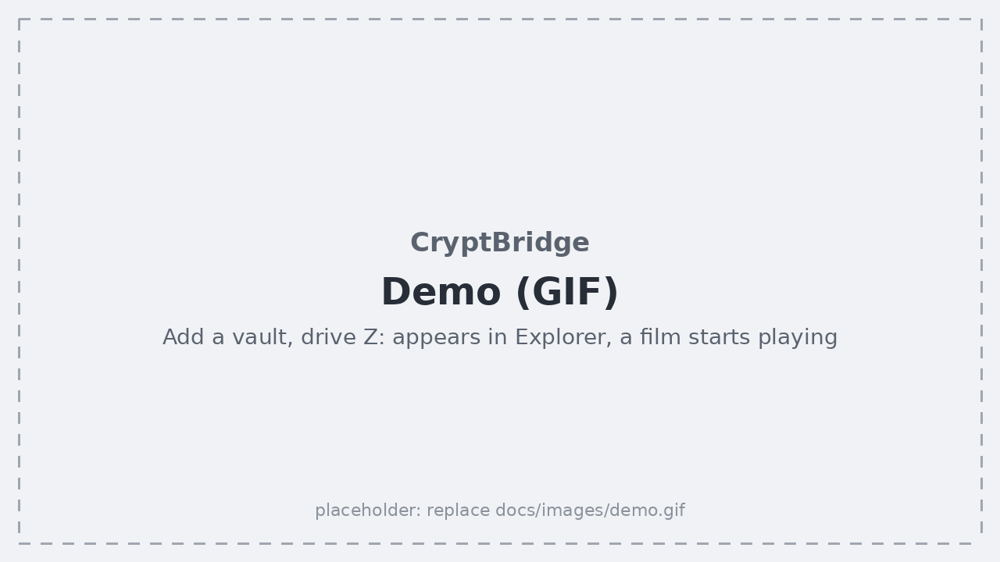
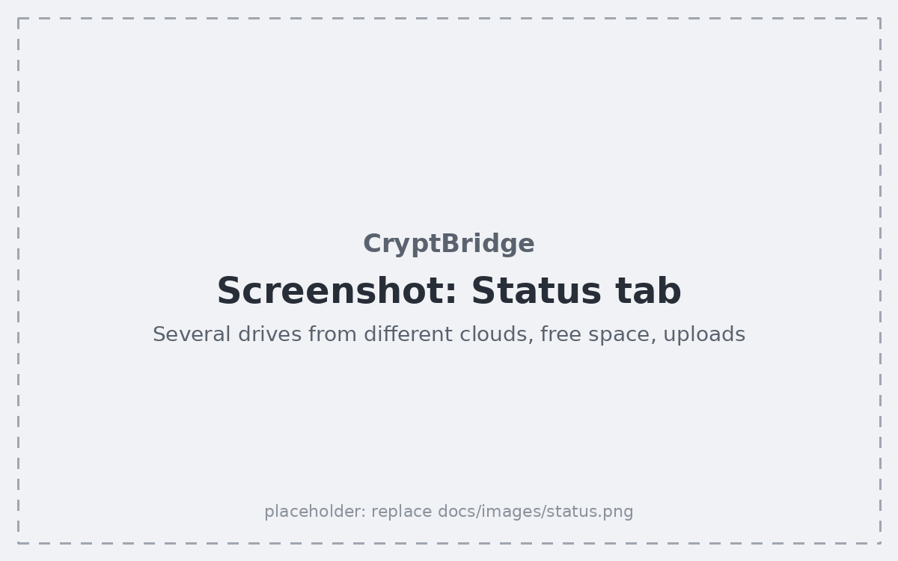
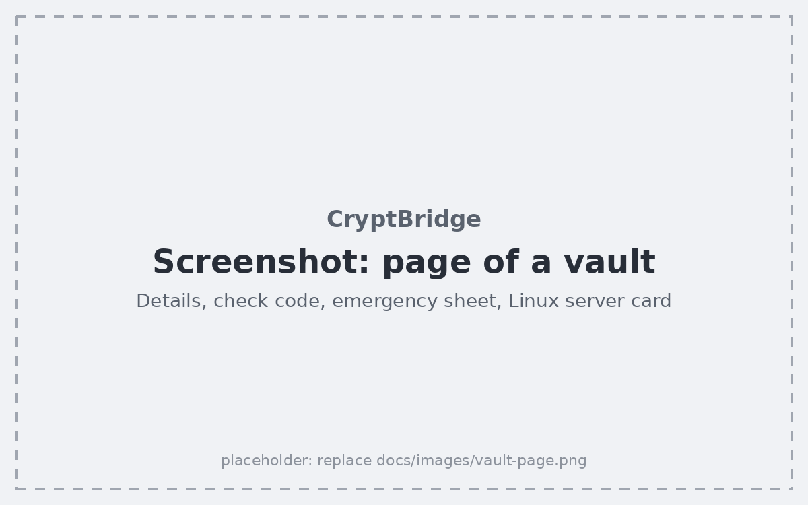
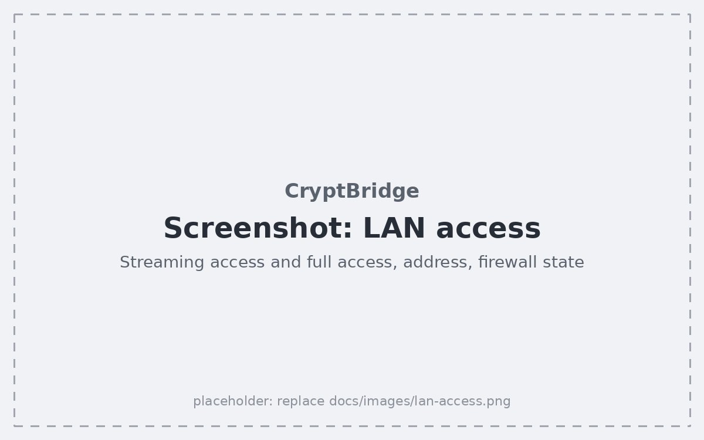
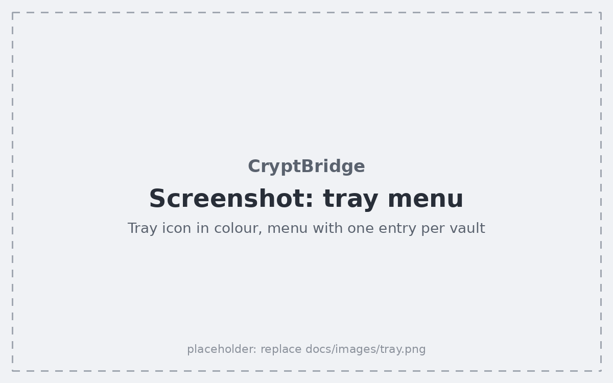
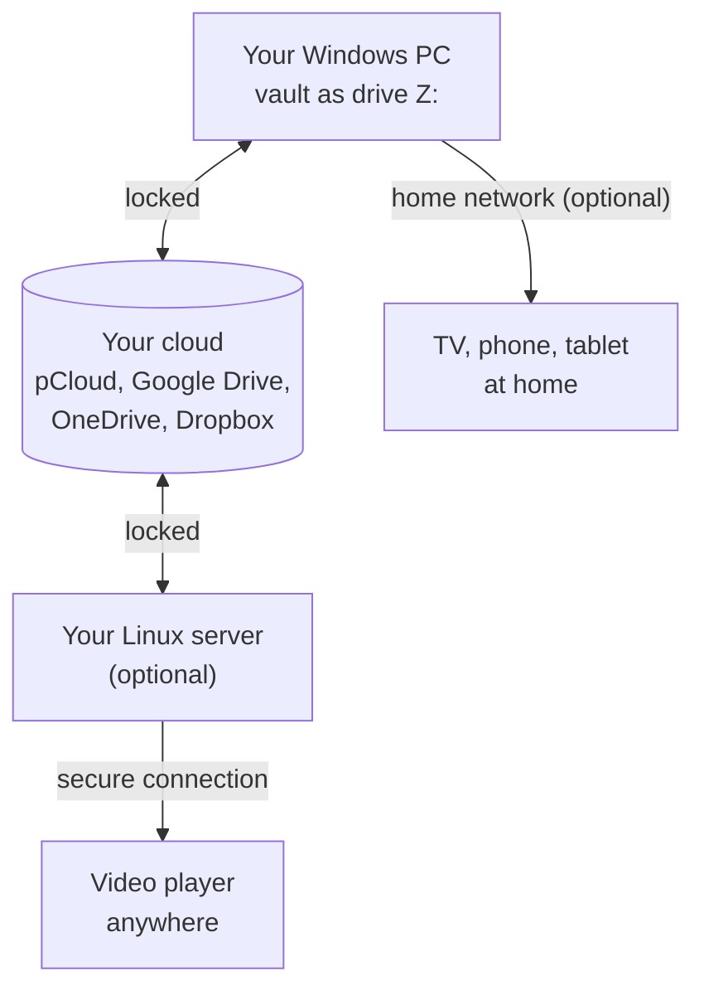

<div align="center">

# 🔐 CryptBridge

### Your cloud, locked with your own key. As easy to use as any other drive.

CryptBridge encrypts your files on your own PC before they go to **pCloud, Google Drive, OneDrive or
Dropbox**, and shows them in Windows as a normal drive. Free, open source, and nobody holds the key but
you.

[](https://github.com/burnersen/CryptBridge/releases/latest)
[](LICENSE)


[](https://ko-fi.com/burnersen)

**[⬇️ Download for Windows](https://github.com/burnersen/CryptBridge/releases/latest)** · **[🚀 Quick start](#-quick-start)** · **[☕ Buy me a coffee](https://ko-fi.com/burnersen)**

</div>

---

## Why CryptBridge?

Whatever you upload to a cloud is only as private as your provider and your account allow. CryptBridge
locks (encrypts) your files **on your own PC first**. The cloud provider, and anyone who might ever get
into your account, only sees scrambled names and contents. Only you hold the key.

On your PC you hardly notice any of this. Your locked folder, called a **vault**, simply shows up as a
drive such as `Z:`. Copy files in, open them, play films, delete them, just as on any other drive.

> **What is a vault?** A normal folder, in your cloud or on a disk or USB stick, whose files are locked
> with two secrets of your choice: a **password** and a **salt** (a second password). Together they are
> the vault's **keys**: without them, the files are useless to anyone, to your cloud provider, to a thief,
> and to me. Technically it is an [rclone crypt](https://rclone.org/crypt/) folder, so you can always open
> it with plain rclone too, even without CryptBridge. Existing rclone crypt vaults work as well.

## What you can do with it

- 🔒 **Lock your cloud.** pCloud, Google Drive, OneDrive and Dropbox, also several accounts at once.
  Tested with all four at the same time, films included.
- 💽 **Use it like any other drive.** Every vault gets its own drive letter in Explorer, and several
  vaults can be open side by side.
- 🔌 **Lock disks and USB sticks, too.** A vault can live on your PC, an external disk or a USB stick,
  with no cloud and no account at all.
- 📺 **Watch your films on the TV.** Share your drives in your home network with Infuse, Kodi and other
  video players: read-only for the TV, full access for devices you trust.
- 🌍 **Stream from anywhere** *(optional, for advanced users)*. One script turns a rented Linux server
  into an HTTPS streaming server for all your vaults, from all four clouds.
- 🆓 **Free, open and without lock-in.** No ads, no tracking, no CryptBridge account. Every vault's
  emergency sheet shows how to open it with plain rclone, so your files never depend on CryptBridge.

## See it in action

<!-- GIF: docs/images/demo.gif (about 1280x720, 10-20 s): Vaults tab > Add vault, choose a cloud,
     open an existing vault, drive Z: appears in Explorer, a film starts playing. -->
<p align="center">
  
</p>

<!-- Screenshots: see docs/images/README.md for what each one should show. -->
<table>
  <tr>
    <td width="50%" valign="top">
      <br>
      <sub><b>Status tab:</b> every drive at a glance, with free space, size and running uploads.</sub>
    </td>
    <td width="50%" valign="top">
      <br>
      <sub><b>A page per vault:</b> check code, emergency sheet and the transfer to your server.</sub>
    </td>
  </tr>
  <tr>
    <td width="50%" valign="top">
      <br>
      <sub><b>LAN access:</b> your films on the TV, with a read-only access for players.</sub>
    </td>
    <td width="50%" valign="top">
      <br>
      <sub><b>Tray icon:</b> green, amber, red or grey tells you how your drives are doing.</sub>
    </td>
  </tr>
</table>

## 🚀 Quick start

**You need** Windows 11 (64-bit) and [WinFsp](https://winfsp.dev/rel/), a free helper that lets Windows
show a vault as a drive. rclone 1.75 or newer does the locking; if it is missing, CryptBridge downloads it
for you and checks that the download is genuine.

1. **Install WinFsp**, then download and start **`CryptBridge.exe`** from the
   [latest release](https://github.com/burnersen/CryptBridge/releases/latest). There is no installer:
   CryptBridge lives in the system tray, next to the clock.
2. **Add your cloud account** (skip this for vaults on your PC): *Vaults tab > Add cloud account*, choose
   the service and sign in in your browser. Google Drive needs [your own free Google app](docs/google-drive-app.md)
   first; the guide is in the program, too.
3. **Add a vault:** *Vaults tab > Add vault*. Create a new one (CryptBridge makes up a strong password and
   salt) or open an existing one with its password and salt. Give it a name and a drive letter.
4. **Done.** The vault appears as a drive right away.

> [!WARNING]
> **Print the emergency sheet, or write down the password and the salt.** Without them nobody can open
> your vault: not your cloud provider, not CryptBridge, not me. There is no "forgot password" for a vault.

Next: turn on the [app lock](docs/windows-app.md#app-lock-recommended), and read
[how to move files you already have](docs/windows-app.md#moving-your-existing-files-into-a-vault)
before you start. Everything else about the program: [Windows program](docs/windows-app.md).

---

## Features at a glance



**🖥️ Windows program** · [guide](docs/windows-app.md)
- One drive letter per vault, several vaults open at once, each with *connect on start*.
- Fast copying through a local cache; uploads continue in the background, and CryptBridge warns you
  before you quit while they run.
- Status tab with free space, vault size and uploads; a tray icon that shows the state in colour.
- App lock with a password of your own, light or dark look, start with Windows, automatic reconnect.

**☁️ Clouds** · [guide](docs/cloud-accounts.md)

| Service | Your own app |
|---|---|
| **pCloud** | optional, recommended: [own pCloud app](docs/pcloud-app.md) |
| **Google Drive** | **required**: [your own Google app](docs/google-drive-app.md) (free, about 15 minutes, once) |
| **OneDrive** | not needed (not possible with a personal Microsoft account) |
| **Dropbox** | optional: [own Dropbox app](docs/dropbox-app.md) |

**🔌 Vaults on your PC or a USB drive** · [guide](docs/windows-app.md#vaults-on-this-pc-or-a-usb-drive)
- No cloud, no sign-in: the folder only ever holds locked files, so a copy of it is a locked backup.
- A USB vault connects when its stick is plugged in, and its drive closes within about two seconds when
  the stick is pulled out.
- Copies of a vault (a backup on a second stick) are never mixed up with the original.

**📺 Home network (LAN access)** · [guide](docs/lan-access.md)
- A **streaming access** (read-only) for TVs and players, and a separate **full access** for file apps.
- Passwords that are easy to type with a TV remote; the share follows your drives and ends when you lock.
- One firewall rule for your private network only. CryptBridge also finds older rules that let rclone in
  everywhere and offers to remove them.
- On the road: through the VPN of your router.

**🌍 Linux server** *(optional)* · [guide](docs/linux-server.md)
- One setup script for Ubuntu and Debian: rclone, Caddy with automatic HTTPS, firewall and fail2ban.
- As many vaults as you like, from all four clouds, each one a folder of the same share and switched on or
  off on its own.
- Keys arrive in an encrypted **transfer block**; the same **check code** on PC and server proves they match.
- Shares ports 80 and 443 with your website: CryptBridge pauses nginx or Apache while streaming is on and
  starts it again afterwards.

---

## 🛡️ Security at a glance

> [!IMPORTANT]
> **Four things only you can do:**
> 1. **Keep the password and the salt safe.** Print each vault's **emergency sheet** and keep it like a
>    house key. Lost keys cannot be recovered by anyone.
> 2. **Turn on the app lock** (*Settings > App lock*). Without it, anyone who uses your Windows account
>    can open your drives and print your emergency sheets.
> 3. **Turn on BitLocker** for the disk with the cache folder. The cache holds readable copies of your
>    files, and Windows remembers file names and preview pictures. Lock Windows when you leave the PC.
> 4. **Use the LAN access only in your home network.** There the files travel unlocked, protected by a
>    password only. Never open it to the internet; use a VPN instead.

**What CryptBridge takes care of:**

- **Wrong keys are caught before they can do harm.** rclone never says "wrong password": with wrong keys
  a vault just looks empty, and new files would be locked with the wrong keys, splitting your vault in
  two. CryptBridge tests the keys when you add a vault and every time before its drive appears.
- **No vault is overwritten by mistake.** A new vault is only created in an empty folder, never inside
  another vault, and two vaults never share a folder.
- **Your keys stay yours.** Settings are encrypted with your Windows account (DPAPI), and with the app
  lock also with Argon2id and AES-256. rclone keeps its configuration in memory only. Locking closes all
  drives and deletes the cache.
- **No typing errors between PC and server.** Sign-in and keys travel in an encrypted transfer block with
  a one-time code.
- **Uploads are never cut off silently,** and drives come back by themselves after a crash or a cloud
  hiccup.

All details, including the small check file `.cryptbridge-vault` in every vault: [Security](docs/security.md).

---

## 📚 Guides

| I want to … | Guide |
|---|---|
| learn the Windows program: tray, vault pages, settings, cache, app lock, USB vaults | [Windows program](docs/windows-app.md) |
| add cloud accounts and know what each service needs | [Cloud accounts](docs/cloud-accounts.md) |
| <a name="google-drive-your-own-google-app-required"></a>set up my own Google app (required for Google Drive) | [Google Drive](docs/google-drive-app.md) |
| set up my own pCloud app (recommended) | [pCloud](docs/pcloud-app.md) |
| set up my own Dropbox app (optional) | [Dropbox](docs/dropbox-app.md) |
| watch films on the TV and other devices at home, or through a VPN | [LAN access](docs/lan-access.md) |
| run my own streaming server | [Linux server](docs/linux-server.md) |
| understand how my files are protected | [Security](docs/security.md) |
| fix a problem | [Troubleshooting](docs/troubleshooting.md) |
| see the rclone settings or build from source | [Technical details](docs/technical.md) |

## Troubleshooting

The most common messages. All of them, sorted by topic: [Troubleshooting](docs/troubleshooting.md).

| Problem | What to do |
|---|---|
| "These keys do NOT open the vault" | Password, salt, folder or an advanced setting does not match. Nothing was changed. Check them against your emergency sheet. |
| A cloud drive does not appear, "could not be checked in …" | The cloud cannot be reached right now (no internet?). The drive appears by itself once the cloud answers. |
| "… no longer accepts the sign-in" | Click **Sign in to … again** on the Status tab. Google Drive: publish your Google app, or Google ends every sign-in after 7 days. |
| pCloud: "Invalid 'client_id'" or error 2095 | Often a passing problem at pCloud; CryptBridge reconnects by itself. For good: your [own pCloud app](docs/pcloud-app.md). |
| Drive letter in use | Choose another letter on the page of the vault (while it is disconnected). |
| A device at home cannot reach the LAN access | *Settings > LAN access* shows the firewall state. Windows must count your network as *private*. |

Log files: Windows `%LOCALAPPDATA%\CryptBridge\logs\rclone.log` · server
`journalctl -u 'rclone-mount-*' -u rclone-webdav -u caddy`

## Updating

- **Windows:** replace `CryptBridge.exe` with the one from the
  [latest release](https://github.com/burnersen/CryptBridge/releases/latest). Your settings and vaults stay.
- **Linux server:** download `setup.sh` again and run it:

  ```bash
  curl -fsSLO https://raw.githubusercontent.com/burnersen/CryptBridge/main/linux/setup.sh
  sudo bash setup.sh
  ```

The [release notes](https://github.com/burnersen/CryptBridge/releases) say what changed in each version.

---

## License

CryptBridge is free software under the [GNU General Public License, version 3](LICENSE), that version only (`GPL-3.0-only`).

- **Use it:** Anyone may use CryptBridge free of charge, at home or at work, and read, change and share its source code.
- **The one condition:** Whoever passes on CryptBridge or parts of it (unchanged, changed or built into a program of their own) must include the complete source code and pass everything on under the same license. A closed, paid product with CryptBridge inside is therefore not possible.
- **Free of charge:** CryptBridge is and stays free. The official source is [github.com/burnersen/CryptBridge](https://github.com/burnersen/CryptBridge). Anyone asking money for CryptBridge is selling you what you can get here for free.
- **A separate license for companies:** Want to build CryptBridge into a product that is not meant to be under the GPLv3? You can ask the author for a separate license: just [open an issue](https://github.com/burnersen/CryptBridge/issues).

There is **no warranty**. Keep your emergency sheet: without the password and the salt, nobody can
open the vault.

### rclone and WinFsp

CryptBridge does **not** bundle rclone or WinFsp. [rclone](https://rclone.org) (MIT License) is used as a
separate program, found on your PC or downloaded from rclone.org on request. [WinFsp](https://winfsp.dev)
(GPLv3 with FLOSS exception) is installed by you from its official site.

### Third-party components

The Windows program is built with these Go libraries. Each keeps its own license, and all of them are
compatible with the GPLv3:

<details>
<summary>Show the list</summary>

- **MIT License:** [Wails](https://github.com/wailsapp/wails) with [go-webview2](https://github.com/wailsapp/go-webview2) and [mimetype](https://github.com/wailsapp/mimetype), [go-toast](https://git.sr.ht/~jackmordaunt/go-toast), [bep/debounce](https://github.com/bep/debounce), [go-ole](https://github.com/go-ole/go-ole), [leaanthony/go-ansi-parser](https://github.com/leaanthony/go-ansi-parser), [leaanthony/slicer](https://github.com/leaanthony/slicer), [leaanthony/u](https://github.com/leaanthony/u), [rivo/uniseg](https://github.com/rivo/uniseg), [samber/lo](https://github.com/samber/lo)
- **Apache License 2.0:** [fyne.io/systray](https://github.com/fyne-io/systray), [tkrajina/go-reflector](https://github.com/tkrajina/go-reflector)
- **BSD 2-Clause License:** [godbus/dbus](https://github.com/godbus/dbus), [pkg/browser](https://github.com/pkg/browser), [pkg/errors](https://github.com/pkg/errors)
- **BSD 3-Clause License:** the [Go standard library](https://go.dev/LICENSE), [golang.org/x/crypto](https://github.com/golang/crypto), [x/net](https://github.com/golang/net), [x/sys](https://github.com/golang/sys), [x/text](https://github.com/golang/text), [google/uuid](https://github.com/google/uuid)

Their copyright notices and full license texts are in the repositories linked above.

</details>

---

## ☕ Support

CryptBridge is free and made in my spare time, on my own hardware and electricity bill. If it keeps your
files safe and your films playing and you'd like to say thanks, you can
[buy me a coffee on Ko-fi](https://ko-fi.com/burnersen). Completely optional, and either way: thank you
for using it!
