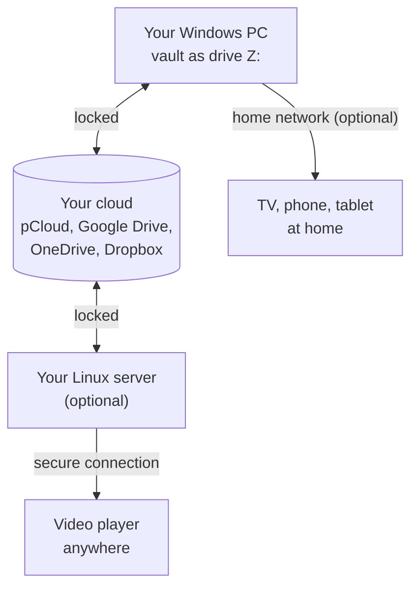

<div align="center">

# CryptBridge

### Your private files in pCloud, Google Drive, OneDrive, Dropbox or on your own disks, locked so that only you can open them, and as easy to use as any other drive.

[](LICENSE)


[](https://ko-fi.com/burnersen)

**[⬇️ Download the latest release](https://github.com/burnersen/CryptBridge/releases/latest)** · **[☕ Buy me a coffee](https://ko-fi.com/burnersen)**

</div>

## What is CryptBridge?

CryptBridge locks (encrypts) your files on your own PC before they go to your cloud:
[pCloud](https://www.pcloud.com), [Google Drive](https://drive.google.com),
[OneDrive](https://onedrive.live.com) or [Dropbox](https://www.dropbox.com). The cloud provider, and anyone
who might ever get into your account, only sees scrambled names and contents. Only you hold the key.

On your PC you hardly notice any of this: your locked folder simply shows up as a drive, for example
`Z:`, and you use it like any other drive. Copy files in, open them, play films, delete them.

**What is a vault?** That is what CryptBridge calls such a locked folder. It is a normal folder, in
your cloud or on a disk or USB stick, whose files are locked with two secrets of your choice: a
**password** and a **salt** (a second password). Together they are the **keys** of the vault. Without
them, the files are useless to anyone: to your cloud provider, to a thief, and to me.

> For the technically minded: a vault is an [rclone crypt](https://rclone.org/crypt/) folder. CryptBridge
> uses the free tool rclone, so you can always open your vaults with plain rclone too, even without
> CryptBridge. Existing rclone crypt vaults work as well.

## What can it do?

- **Drives on Windows.** Every vault gets its own drive letter. Several vaults can be open at once:
  vaults in your clouds, and [vaults on your PC or a USB drive](#vaults-on-this-pc-or-a-usb-drive) that
  need no cloud and no account at all.
- **Several clouds at once.** pCloud, Google Drive, OneDrive and Dropbox, also several accounts of the
  same service. See [Cloud accounts](#cloud-accounts).
- **Films on your TV at home (optional).** Your PC can share its drives with the TV, phone or tablet in
  your home network, for example for video players such as Infuse or Kodi. See
  [LAN access](#lan-access-optional).
- **Your own streaming server (optional, for advanced users).** A setup script turns a rented Linux
  server into a streaming server for your vault, reachable from anywhere over a secure connection.
  See [Linux server](#linux-server).
- **Free and open source:** no ads, no tracking, no CryptBridge account.



---

## Get started on Windows

**What you need**

- Windows 11 (64-bit).
- [WinFsp](https://winfsp.dev/rel/), a free helper that lets Windows show a vault as a drive.
  CryptBridge tells you if it is missing.
- rclone 1.75 or newer, the tool that does the locking. If it is missing, CryptBridge downloads it for
  you from rclone.org and checks that the download is genuine.
- For vaults in the cloud: an account at pCloud, Google Drive, OneDrive or Dropbox. Google Drive also
  needs [your own free Google app](#google-drive-your-own-google-app-required).

**Four steps**

1. **Install WinFsp**, then download and start **`CryptBridge.exe`** from the
   [latest release](https://github.com/burnersen/CryptBridge/releases/latest). There is no installer.
   CryptBridge lives in the system tray, the small icons at the bottom right next to the clock.
2. **Add your cloud account** (only for vaults in the cloud): *Vaults tab > Add cloud account*, choose
   the service and click *Sign in*. Your browser opens the sign-in page of the service; sign in there and
   allow the access. For Google Drive, set up your own Google app first: the guide is right there on
   the page. See [Cloud accounts](#cloud-accounts) for what each service needs.
3. **Add a vault:** *Vaults tab > Add vault*. Choose where it is (**in one of your cloud accounts** or
   **on this PC or a USB drive**), then:
   - **Create a new vault:** CryptBridge makes up a strong password and salt for you.
   - **Open an existing vault:** enter its password and salt. *Browse* shows your folders (vaults are
     marked with a lock); *Search* finds vaults anywhere in that cloud.

   Give the vault a name and a drive letter.
4. **Done.** The vault appears as a drive right away. The **Status tab** shows all drives, how much
   space is left where they live, their size and running uploads.

> ⚠️ **Write down the password and the salt, or print the emergency sheet.** Without them nobody can
> open your vault: not your cloud provider, not CryptBridge, not me. There is no "forgot password" for a
> vault.

### The tray icon

| Colour | Meaning |
|---|---|
| **Green** | connected |
| **Amber** | working or uploading: please do not switch the PC off now |
| **Red** | a drive has a problem |
| **Grey** | disconnected, or CryptBridge is locked |

Its menu connects or disconnects all drives, or each one on its own. Closing the window keeps
CryptBridge running; **Quit** is in the tray menu.

### Your vaults and settings

Every vault has its own page on the **Vaults tab**. There you find its details and its check code, can
change its name, drive letter and *connect on start*, print its **emergency sheet** (one page with
everything needed to open the vault again, even without CryptBridge), bring it to a
[Linux server](#linux-server) (vaults in the cloud), or *Remove from CryptBridge*. Removing asks for the
vault's name to be sure, and never touches the files in the vault.

On the **Settings tab**: light or dark look (or *automatic*, like Windows), *start with Windows*,
*reconnect automatically*, the [app lock](#app-lock-recommended), the [LAN access](#lan-access-optional)
and the **cache**.

**The cache** is a folder on your PC where files wait for a short time. Copying to a drive is fast
because files land there first and are then uploaded in the background. It is shared by all drives and
needs room for the largest file you copy at once. It holds readable copies of your files, so turn on
**BitLocker** (Windows' own disk encryption) for that disk.

---

## What makes it safe

- **Wrong keys are caught before they can do harm.** rclone never tells you "wrong password". With
  wrong keys (password and salt), a vault simply looks empty, and everything you copy into it would be
  locked with the wrong keys. Your vault would then be split into two parts that no single password
  opens. That is why CryptBridge tests the keys when you add a vault and every time before its drive
  appears, and refuses keys that do not fit. A small [check file](#the-file-cryptbridge-vault) in every
  vault helps with this.
- **No vault is overwritten by mistake.** A new vault is only created in an empty folder, never inside
  another vault, and two vaults never share a folder. A vault on a USB drive connects only to its very
  own folder, not to a copy on another stick that got the same drive letter, and its drive closes at
  once when the folder disappears.
- **No typing errors between PC and server.** The Windows program packs sign-in and keys into an
  encrypted *transfer block*, a piece of text you paste into the server setup together with a one-time
  code.
- **Your keys stay yours.** On Windows, CryptBridge's settings are encrypted with your Windows account
  (DPAPI), and rclone keeps its configuration in memory only. With the optional
  [app lock](#app-lock-recommended), they are also sealed with a password of your own. On the server,
  only your user can read the keys.
- **Uploads are never cut off silently.** CryptBridge shows running uploads and warns you before you
  disconnect or quit while they run.
- **The drive survives problems.** rclone runs as a program of its own: if the window crashes, the drive
  stays; if rclone stops, CryptBridge brings the drive back. If a cloud refuses the sign-in, CryptBridge
  says so plainly, asks again every minute and reconnects by itself once the cloud accepts it again.
  Without internet, a cloud drive does not appear at first, because its keys cannot be tested yet. It
  appears by itself as soon as the cloud can be reached again.
- **Sign-ins stay fresh.** Some clouds (Microsoft above all) hand out a new sign-in every time the old
  one is renewed. CryptBridge keeps the new one, so you do not have to sign in again every few months.

### The file `.cryptbridge-vault`

Every vault holds a small file named `.cryptbridge-vault`. It is not clutter. CryptBridge uses it to
make sure that the keys you entered really belong to this vault: only with the right keys can it find
and read this file. The Windows program looks for it when you add the vault and every time before its
drive appears, the Linux setup when it sets up the server. The file contains just two lines of text
that say what it is for.

You do not see it on the drives, in the LAN access or in the server's vault folder, but it stays in the
vault. You may still meet it where the vault is opened another way, for example with plain rclone.

**Please keep it.** Deleting it does not harm your files. The key test still works without it, using
some of your other files, but it is less certain until the file is back. The Windows program puts it
back by itself the next time the drive connects.

---

## Vaults on this PC or a USB drive

A vault does not have to be in the cloud. It can also be a folder on any disk of your PC: an internal
disk, a USB stick, an external disk, or a network folder that has a drive letter. It is locked and
unlocked only on your PC, the same way as in the cloud, and needs neither a cloud nor a sign-in. The
folder itself only ever holds locked files, so you can copy it to another disk as a backup and it stays
locked.

- **USB drives:** with *connect on start*, the vault connects as soon as its drive is plugged in (while
  CryptBridge is running). If the drive is pulled out while the vault is connected, CryptBridge closes
  the vault's drive within about two seconds. Please disconnect first anyway, as with any USB drive.
  Files that were still being written stay on the PC and are written into the vault when it is back.
- **Copies are not mixed up:** if a copy of the vault (for example a backup on a second stick) shows up
  in the same place, CryptBridge does not connect it by itself but asks first. Otherwise your changes
  would end up in the wrong copy. The same happens if you move the vault to a new disk: confirm once with
  the button *This is my vault*.
- **The check code** of a vault on your PC does not depend on the drive letter its disk gets.
- **The cache:** a local disk is fast, so only files being written pass through the cache, and they
  leave it a minute after their last use.
- Not possible on a Windows disk: vaults whose file names use the *base64* setting. Windows does not
  tell upper from lower case in file names, so two locked names could land on the same file. The same
  goes for OneDrive and Dropbox.

---

## App lock (recommended)

Without an app lock, anyone who uses your Windows account, or sits at your PC while it is unlocked, can
open your drives and print your emergency sheets. Set an **app password** at *Settings > App lock*
(CryptBridge also offers it once after setup). Then:

- CryptBridge **starts locked** and asks for the app password once after Windows starts. If a vault
  connects on start, the password window appears by itself.
- It **locks itself together with Windows** (`Win+L`, the automatic screen lock, signing out) and asks
  again when you are back. Your drives connect again after unlocking.
- **Locked means nothing readable is left behind.** All drives are closed, the cache with readable copies
  of recently used files is deleted, and sign-in, vault folders and keys are kept only sealed with your
  app password (Argon2id and AES-256, on top of the Windows encryption). Running uploads are finished
  first. When you sign out of Windows there is no time for that: waiting files stay in the cache and are
  uploaded after the next unlock.
- **Emergency sheets** and **transfer blocks** ask for the app password again.
- After a wrong password, the next try has to wait a little longer (up to 30 seconds).

**Forgot the app password?** It cannot be recovered, but your files are not lost. Click *Forgot the app
password?* on the lock screen, then *Reset CryptBridge*. Add your cloud accounts again, then your vaults
with the password and salt from their **emergency sheets**.

What the app lock cannot do: Windows itself remembers recently opened file names and preview pictures,
and deleted files can be recovered from an unencrypted disk. Turn on **BitLocker** for the disk with the
cache folder, and lock Windows when you leave the PC.

---

## Cloud accounts

Add your clouds at *Vaults tab > Add cloud account*. Each account gets its own page there, with the
sign-in, the free space, a name you can change, and *Remove from CryptBridge* (possible once no vault
lies in it; your files in the cloud are never touched). You can add several accounts of the same
service, for example a private and a work Google Drive.

| Service | Sign-in | Own app |
|---|---|---|
| **pCloud** | in the browser; CryptBridge finds out by itself whether your account is in the EU or the US | optional, recommended: [own pCloud app](#own-pcloud-app-recommended) |
| **Google Drive** | in the browser | **required**: [your own Google app](#google-drive-your-own-google-app-required) |
| **OneDrive** | in the browser with your Microsoft account | not possible with a personal Microsoft account, so rclone's access is used |
| **Dropbox** | in the browser | optional: [own Dropbox app](#own-dropbox-app-optional) |

**Signing in** works the same everywhere: CryptBridge opens the sign-in page of the service in your
browser, you sign in there and allow the access, and CryptBridge continues by itself. Your password for
the cloud is typed only on the page of the service; CryptBridge never sees it. If the service has a
question afterwards (OneDrive, for example, if your account has more than one drive), CryptBridge shows it
in a small window. If you close the browser instead, click *Cancel* in CryptBridge.

Good to know:

- **Tested (October 2026)** with pCloud, Google Drive, OneDrive and Dropbox at the same time, including
  films streamed from all of them.
- **OneDrive:** the *Personal Vault* of OneDrive and files *shared with you* cannot be used for a vault.
  Choose a normal folder.
- **Dropbox:** CryptBridge uploads files to Dropbox one by one. Dropbox may slow this down a little when
  you copy very many small files at once; rclone then waits and carries on by itself.
- **Linux server:** the [server setup](#linux-server) works with vaults in all four clouds (since
  CryptBridge 0.8).
- **Updating from CryptBridge 0.6 or older:** your pCloud account and your vaults are taken over by
  themselves when CryptBridge 0.7 starts (with the app lock: when you unlock it). The old settings stay
  next to the new ones as `settings.dat.v2-backup`. Older versions of CryptBridge cannot read the new
  settings.

### Own Dropbox app (optional)

Without an app of your own, CryptBridge uses rclone's shared access to Dropbox, which works. Your own app
keeps you independent of the limits that access shares with every rclone user. It takes about five
minutes and needs no approval:

1. Open the **[Dropbox App Console](https://www.dropbox.com/developers/apps)**, sign in and click
   **Create app**. Choose **Scoped access** and **Full Dropbox**, and give it a name of your own, for
   example "CryptBridge" followed by your name (Dropbox wants names that nobody else uses).
2. On the **Permissions** tab, tick `account_info.read`, `files.metadata.write`, `files.content.write`,
   `files.content.read` and `sharing.write`, then click **Submit**.
3. On the **Settings** tab, add `http://localhost:53682/` under **OAuth 2 Redirect URIs** and click
   **Add**.
4. In CryptBridge, enter the **App key** as *Client ID* and the **App secret** as *Client secret*: when
   you add the account, or later on the page of your Dropbox account (then sign in again).

---

## Google Drive: your own Google app (required)

Google is retiring the shared access that all rclone users had (Google wants to charge for it during
2026). So CryptBridge signs in to Google Drive only through **an app of your own**. Setting it up takes
about 15 minutes, once, and costs nothing. One app serves all your Google accounts. The same guide is in
CryptBridge on the page for adding a Google Drive account, with Copy buttons.

1. Open the **[Google Cloud Console](https://console.cloud.google.com/projectcreate)** and sign in with
   your Google account. Create a new project, for example `CryptBridge`, and make sure it is selected at
   the top of the page.
2. Turn on the **[Google Drive API](https://console.cloud.google.com/apis/library/drive.googleapis.com)**:
   click **Enable**.
3. Open the **[Google Auth Platform](https://console.cloud.google.com/auth/overview)** and click **Get
   started**. App name `CryptBridge (personal)`, your own email address as support and contact address,
   audience **External**. Agree and click **Create**.
4. Open **[Data access](https://console.cloud.google.com/auth/scopes)**, click **Add or remove scopes**
   and add `https://www.googleapis.com/auth/drive` (tick it in the list, or paste it under *Manually add
   scopes*). Click **Update**, then **Save**.
5. Open **[Audience](https://console.cloud.google.com/auth/audience)**, add your own Google address under
   **Test users**, then click **Publish app** and confirm. Important: while the app stays in *Testing*,
   Google ends every sign-in after 7 days. If Google asks for a homepage and a privacy policy first,
   enter them under **Branding**, for example `https://github.com/burnersen/CryptBridge`.
6. Open **[Clients](https://console.cloud.google.com/auth/clients)**, click **Create client**, choose the
   application type **Desktop app**, name it `CryptBridge` and click **Create**.
7. Copy the **Client ID** and the **Client secret** into CryptBridge (*Add cloud account > Google Drive*)
   and click *Sign in*.
8. Google then warns that it has not verified the app. That is expected: it is your own app, which only
   you use. Click **Advanced**, then **Go to CryptBridge (personal) (unsafe)** and **Continue**.

The client ID and secret are stored encrypted with your Windows account, like your sign-ins.

---

## Own pCloud app (recommended)

CryptBridge talks to pCloud through rclone. Out of the box it uses **rclone's shared pCloud access**,
which all rclone users share. pCloud has blocked it for hours before: on 5 October 2026, for about
three hours, the browser showed *Invalid 'client_id'* and existing sign-ins failed with *error 2095*.

With an **app of your own** (free, at pCloud), CryptBridge no longer depends on that shared access.
**Your vaults do not change:** same keys, same files, same check codes. You only sign in once more.

> **Tested (October 2026)** with an approved pCloud app: the sign-in works, and the pCloud drives connect
> through it. The own app is optional: CryptBridge also works right away with rclone's shared access.

Request the app **now, while everything works**: pCloud has to approve it, which took about a day for me.

1. Open **[My Apps on pCloud](https://docs.pcloud.com/my_apps/)**, log in with your pCloud account and
   request a new application.
2. Fill in the form like this and click **Create request**:

   | Field | Enter |
   |---|---|
   | App name | `CryptBridge (personal)` |
   | Application Type | **Personal use** |
   | Folder access | **All folders**, because your vaults are normal folders in your pCloud (*Private* would most likely limit the app to a folder of its own) |
   | Write access | **Yes**, needed to upload files |
   | Website | `https://github.com/burnersen/CryptBridge` |
   | Expected number of users | `1` |
   | Reason | the text below (also in CryptBridge on the page of your pCloud account, with a Copy button) |

   ```text
   Personal use only. I use the open-source tool CryptBridge (https://github.com/burnersen/CryptBridge), which is based on rclone, to access my own pCloud account: it shows an encrypted folder of my pCloud as a drive on my own computers. Only my own pCloud account will use this app. It needs access to all folders because my existing encrypted folders are not inside an app folder, and write access to upload my files.
   ```

3. Once pCloud has approved the app, open it on My Apps, switch to **Settings** and enter
   `http://localhost:53682/` under **Redirect URIs**, exactly like this. Without it, the sign-in ends with
   *redirect_uri is not authorized*. Set *Allow implicit grant* to **Disallow** (CryptBridge does not need
   it). Publisher, description and icon can stay empty. Click **Save changes**.
4. In CryptBridge, on the page of your pCloud account (*Vaults tab*, under *Cloud accounts*), section
   *Own pCloud app*: paste the **Client ID** and the **Client secret**, click **Save app** and confirm the
   new sign-in. Connected pCloud drives are disconnected for the sign-in and connected again afterwards.
   The page then says *… through your own app*.
5. **Linux server** (not urgent: its sign-in keeps working until pCloud blocks rclone's shared access
   again): create a new transfer block on the page of the vault, run the setup on the server again (with
   the current `setup.sh`, see [Setup](#setup)), answer **n** to *Keep the cloud sign-in and vault keys
   from the last setup?* and paste the block.

Client ID and secret are stored encrypted with your Windows account like the rest of the settings. They
are used only for signing in and are not part of the transfer block: the server needs only the sign-in.

---

## LAN access (optional)

**Watch your films on the TV at home.** CryptBridge can share the connected drives with the other
devices in your home network (LAN): a TV or Apple TV with a video player such as Infuse or Kodi, a phone,
a tablet, a Mac. Every connected drive appears there as a folder, protected with a user name and
password. The devices connect over **WebDAV**, a common standard for sharing files over a network that
most video players and file apps understand.

There are **two accesses**, each with its own user name and password, turned on separately at
*Settings > LAN access*:

| Access | Suggested port and user | What the devices may do | For |
|---|---|---|---|
| **Streaming access** | `8080`, `stream` | open, play and copy files, but never change or delete anything | TVs and video players |
| **Full access** | `8081`, `full` | also upload, rename and delete | file apps on devices you trust |

The **port** is like a door number on your PC; change it only if another program already uses it. The
address then looks like `http://192.168.1.20:8080/`, and the Settings page shows the right one for your
PC. CryptBridge suggests passwords that are easy to type with a TV remote, and refuses the same password
for both accesses: the streaming password is typed on TVs, where others may see it, and must never open
the full access.

- **On your devices:** in a video player (Infuse, Kodi), add a WebDAV share with the address, port, user
  name and password of the **streaming access** (protocol `http`, path `/`). A file app on a phone or
  tablet gets the **full access** the same way. On a Mac: *Finder > Go > Connect to Server*.
- **It follows the drives.** A drive that connects appears in the network; a drive leaves the network
  before it disconnects. Locking CryptBridge ends the LAN access at once. The PC has to be switched on
  and awake.
- **Only your home network.** When you turn it on, Windows asks once for permission (the usual
  administrator prompt) to let the devices of your home network in. This works only if Windows counts
  your home network as **private**. If it does not, CryptBridge tells you; change it in *Windows Settings
  > Network & internet > your connection > Network profile type*.
- **Please note:** inside your home network the files travel **unlocked**, protected by the password
  only. Do not turn the LAN access on in networks you do not trust, such as a hotel or café.
- **Other Windows PCs** do not accept this kind of password-protected address without changing their
  registry. Install CryptBridge there instead.

<details>
<summary><b>Technical details: firewall rule and changes from the network</b></summary>

- CryptBridge asks Windows for one firewall rule: inbound connections to the ports of the accesses that
  are on, for rclone only, from devices of the same network, and only on networks Windows counts as
  private. Turning both accesses off removes the rule again (Windows asks once more); turning the second
  one on or changing a port updates it.
- The connection inside the home network is plain HTTP, without TLS.
- Changes from the network (full access only) go into the drive's upload queue, like files copied in
  Explorer.

</details>

### Away from home: VPN into your home network

Never open the LAN access to the internet on your router. To use it on the road, connect your phone,
tablet or laptop to your home network through a **VPN** (a secure tunnel into your home network). The
device then reaches the LAN access as if it were at home, the VPN encrypts the whole way, and your own PC
at home does the job of a rented server. How smoothly films play then depends on the upload speed of
your internet connection at home.

The VPN has to give your devices an address of your home network:

- **The VPN of your router** (WireGuard), for example of a FRITZ!Box: works, nothing to change in
  CryptBridge.
- **Tailscale with a subnet router** in your home network (a router, NAS or Raspberry Pi that makes
  your home network reachable): works as well.
- **Tailscale running only on this PC** is *not* supported yet: its devices get addresses of their own
  (100.x.x.x), which CryptBridge's firewall rule does not let in.

*Not tested yet.* Reports are welcome.

---

## Linux server

*Optional, for advanced users.* Want to watch your films anywhere, without your PC at home running? Rent
a small Linux server (a VPS) and let one setup script turn it into a streaming server for your vault in
pCloud, Google Drive, OneDrive or Dropbox. Your video player, for example **Infuse** on Apple TV, iPhone
or iPad, then plays straight from it over a secure connection (HTTPS). On the server itself, the vault is
the folder `~/CryptBridge`.

Tested on **Ubuntu 26.04 with an XFCE desktop**, on a server that already had its own firewall rules,
fail2ban jails and third-party package sources, with vaults in all four clouds. Made for Ubuntu 24.04 and Debian 12 and 13 as well (not
tested there yet), with or without a desktop.

### Before you start

- A **host name** for your server, an internet address like `myvault.duckdns.org`: your own domain, or a
  free name from [DuckDNS](https://www.duckdns.org) (sign in, create a name, set its IP to your server's
  IP). The certificate for the secure connection is fetched automatically for it.
  > ⚠️ Host names of your provider (netcup's `…supersrv.de`, Contabo's `…contaboserver.net`) often do
  > **not** work: all customers share one limit of 50 certificates per week at Let's Encrypt, and it is
  > usually used up. DuckDNS names have a limit of their own.
- **Ports 80 and 443** must be reachable, also in your provider's firewall if it has one.
- A **transfer block** of your vault from the Windows program (*Vaults tab > the page of the vault >
  Linux server*), or its keys at hand.

### Setup

```bash
curl -fsSLO https://raw.githubusercontent.com/burnersen/CryptBridge/main/linux/setup.sh
sudo bash setup.sh
```

The setup asks a few questions and does everything else. When it asks for the keys, paste the
**transfer block** and type its code. At the end it shows a **check code** (for example `7F3A-91C2`): it
must be the same as on the vault's page in the Windows program. If the codes match, the keys match.

**Server set up with CryptBridge 0.7 or older?** Download `setup.sh` again (the two lines above) before
you paste a transfer block of CryptBridge 0.8 or newer: the old setup only knows the old blocks and would
report a wrong code. The new setup takes over everything of the old one.

Afterwards, the command `cryptbridge` (or the *CryptBridge* desktop icon) shows the status and the
settings for your player, restarts the services or runs the setup again. `cryptbridge streaming` shows
the settings for your player directly. `sudo cryptbridge uninstall` removes everything except your files
in the cloud.

<details>
<summary><b>Technical details: what the setup does</b></summary>

| Step | What happens |
|---|---|
| Packages | rclone (checksum verified), Caddy from Ubuntu/Debian, fuse3, ufw, fail2ban, apache2-utils |
| Keys | paste the transfer block and type its code, or enter everything by hand (pCloud only); the sign-in is kept in `/etc/cryptbridge/rclone/`, where rclone may renew it (Google Drive, OneDrive and Dropbox do so about every hour) |
| Check | keys tested against your vault; the check code must equal the one in the Windows program |
| Vault | mounted at `~/CryptBridge` for your desktop user (`rclone-mount.service`) |
| Streaming | WebDAV for your video player, read-only (`rclone-webdav.service`), behind Caddy with HTTPS; if rclone crashes, both services come back by themselves |
| Firewall | allows 80/443 in ufw (also when ufw stays off, so they are open once it is switched on later), and keeps your SSH and remote-desktop ports open before switching ufw on |
| Protection | the streaming access is read-only, so a guessed password cannot delete anything; repeated wrong passwords are blocked by fail2ban |
| Desktop | icons *CryptBridge Vault* and *CryptBridge*, a file-manager bookmark, no film thumbnails |

</details>

### Video players

Any video player that can open a WebDAV share over HTTPS can play from the server. It needs these
values:

| Field | Value |
|---|---|
| Protocol | WebDAV, HTTPS on |
| Address | your server's host name |
| Port | 443 |
| Path | `/` |
| User / password | the user name and password you chose in the setup |

Tested with **Infuse** on Apple TV, iPhone and iPad: *Settings > Shares > Add share > WebDAV*.

> 💡 **For smooth 4K playback in Infuse:** go to *Settings > Playback (Streaming) > Buffer* and set it to
> **Generous**.

### Moving to a new server

1. Run the setup on the new server (paste a fresh transfer block, or copy `/etc/cryptbridge/` over).
2. Check that the check code is the same.
3. Point your host name to the new server. With your own domain your player needs no change at all; with
   a provider host name, enter the new name in the player once.
4. Uninstall on the old server: `sudo cryptbridge uninstall`.

Your files stay in the cloud the whole time; the servers only pass them through.

---

## Moving your existing files into a vault

Copy them onto the vault's drive (on the server: into `~/CryptBridge`), check that they arrived, then
delete the originals. Plan for space: **until you delete an original, the file is in your cloud twice**
(unlocked and locked). Move in portions that fit into your free space in the cloud, and check whether
deleted files still count against your storage while they sit in the cloud's trash.

---

## Troubleshooting

| Problem | What to do |
|---|---|
| "These keys do NOT open the vault" | Password, salt, folder or an advanced setting does not match. Nothing was changed. Check them against your emergency sheet. |
| "The keys … do not open the folder" (vault on your PC) | Another drive got the vault's drive letter. Nothing was connected or written. |
| "The folder … in … is empty or gone" | The vault's folder in the cloud was renamed or moved. Nothing was connected or written. Rename it back, or add the vault again from its new place. |
| A cloud drive does not appear, "could not be checked in …" | The cloud cannot be reached right now (no internet?). The drive appears by itself once the cloud answers. |
| "pCloud no longer accepts the sign-in (error 2095)" | Often a passing problem at pCloud: CryptBridge asks again every minute and reconnects by itself. After a password change or "log out of all devices" it stays: click **Sign in to … again** on the Status tab, then bring the sign-in to the server with a new transfer block. |
| "… no longer accepts the sign-in: it has run out or was withdrawn" | Click **Sign in to … again** on the Status tab. Google Drive: if your Google app is still in *Testing*, Google ends every sign-in after 7 days; publish the app (step 5 of the [Google guide](#google-drive-your-own-google-app-required)). |
| "… does not accept your own app" | The client ID or secret is wrong, or the app was deleted. Correct them on the page of the account, then sign in again. |
| Google shows "Google hasn't verified this app" | Expected with your own Google app: click **Advanced**, then **Go to … (unsafe)**. |
| "the port 53682 that receives the sign-in is in use" | Another sign-in is still waiting, perhaps in a window of rclone. Finish or close it and try again. |
| pCloud page shows "Invalid 'client_id'" during sign-in | pCloud is blocking rclone's shared access. Try again later, or use your [own pCloud app](#own-pcloud-app-recommended). With your own app: check the client ID on the page of your pCloud account. |
| Browser shows "redirect_uri is not authorized" (or similar) | Add `http://localhost:53682/` to the redirect addresses of your own pCloud or Dropbox app. A Google desktop app needs no such address. |
| Check codes differ between PC and server | The keys or settings differ. Bring them over again with a transfer block. |
| Drive letter in use | Choose another letter on the page of the vault (while it is disconnected). |
| Quit warns about uploads | Files not yet in the vault stay on this PC and are written into it the next time you connect. Do not delete the cache folder in the meantime. |
| A vault on a USB drive says "Waiting for its folder" | Its drive is not plugged in (or got another letter). It connects by itself when the folder is back. If the drive now has another letter, add the vault again from there and remove the old entry. |
| "… is not the folder the drive was last connected to" | Another drive with a copy of the vault, or the vault was moved. If it is the vault you want to work with from now on, click *This is my vault*. |
| Remove refuses: files still wait | Connect the vault and let the uploads finish; removing it now would lose those files. |
| A device at home cannot reach the LAN access | *Settings > LAN access* shows the firewall state: allow it there if needed, and set your network to *private* in Windows if CryptBridge says it is public. Use the address shown there; the PC must be awake. |
| LAN access: "port … is used by another program" | Choose another port (1024 to 65535) for that access and save. The two accesses need different ports. |
| The video player cannot reach the server | Run `cryptbridge` on the server: it shows which service is not running. Check ports 80 and 443 at your provider. |
| No certificate on the server, log says `rateLimited` | Your provider's host name shares Let's Encrypt's weekly limit with all customers. Use a DuckDNS name or your own domain and run `sudo cryptbridge setup` again (keep the keys and the account). |

Log files: Windows `%LOCALAPPDATA%\CryptBridge\logs\rclone.log` · server
`journalctl -u rclone-mount -u rclone-webdav -u caddy`

---

## Technical details

<details>
<summary><b>Streaming settings (rclone options)</b></summary>

Used by the Windows drive and by the server mount (the server's WebDAV reads from that mount):

| rclone option | Value | Why |
|---|---|---|
| `--buffer-size` | 128M | absorbs network hiccups in memory |
| `--vfs-read-chunk-size` / `-limit` | 64M / 1G | fast start of a film, then large reads |
| `--vfs-cache-mode` | full | reads and writes go through a disk cache |
| `--vfs-cache-max-size` | 20G (server: half the free space at most) | keeps the disk from filling up |
| `--vfs-cache-min-free-space` | 10G Windows / 5G server | emergency brake for the disk |
| `--vfs-read-ahead` | 128M | reads ahead of the player |
| `--dir-cache-time` / `--poll-interval` | 24h / 1m | fast browsing; the cloud reports changes every minute |

`--no-modtime` is used for the server's WebDAV only. The drives keep real file dates: the clouds deliver
them with every folder listing, so they cost nothing, and you can sort by date.

Dropbox accounts get `batch_mode off`. With rclone's default batch uploads, a key check that rclone drops
from its cache ends the upload batcher of the same Dropbox folder, and every later upload fails with
*batcher is shutting down*.

Vaults on the PC do not need any of the streaming values: they use `--vfs-cache-mode writes`,
`--vfs-cache-max-age 1m` and `--dir-cache-time 10s`.

</details>

<details>
<summary><b>Building from source</b></summary>

Windows program (Go 1.27 as set in `windows/go.mod`, PowerShell 7):

```powershell
pwsh -File windows\build.ps1
```

The version lives in one place, the file `VERSION`; the build script writes it into the program, its file
properties and `linux/setup.sh`. Tests: `go test ./...` in `windows/`, `bash linux/tests/functions_test.sh`.

</details>

---

## License

CryptBridge is free software under the [GNU General Public License, version 3](LICENSE), that version only (`GPL-3.0-only`).

- **Use it:** Anyone may use CryptBridge free of charge, at home or at work, and read, change and share its source code.
- **The one condition:** Whoever passes on CryptBridge or parts of it (unchanged, changed or built into a program of their own) must include the complete source code and pass everything on under the same license. A closed, paid product with CryptBridge inside is therefore not possible.
- **Free of charge:** CryptBridge is and stays free. The official source is [github.com/burnersen/CryptBridge](https://github.com/burnersen/CryptBridge). Anyone asking money for CryptBridge is selling you what you can get here for free.
- **A separate license for companies:** Want to build CryptBridge into a product that is not meant to be under the GPLv3? You can ask the author for a separate license: just [open an issue](https://github.com/burnersen/CryptBridge/issues).

There is **no warranty**. Keep your emergency sheet: without the password and the salt, nobody can
open the vault.

### rclone and WinFsp

CryptBridge does **not** bundle rclone or WinFsp. [rclone](https://rclone.org) (MIT License) is used as a
separate program, found on your PC or downloaded from rclone.org on request. [WinFsp](https://winfsp.dev)
(GPLv3 with FLOSS exception) is installed by you from its official site.

### Third-party components

The Windows program is built with these Go libraries. Each keeps its own license, and all of them are
compatible with the GPLv3:

- **MIT License:** [Wails](https://github.com/wailsapp/wails) with [go-webview2](https://github.com/wailsapp/go-webview2) and [mimetype](https://github.com/wailsapp/mimetype), [go-toast](https://git.sr.ht/~jackmordaunt/go-toast), [bep/debounce](https://github.com/bep/debounce), [go-ole](https://github.com/go-ole/go-ole), [leaanthony/go-ansi-parser](https://github.com/leaanthony/go-ansi-parser), [leaanthony/slicer](https://github.com/leaanthony/slicer), [leaanthony/u](https://github.com/leaanthony/u), [rivo/uniseg](https://github.com/rivo/uniseg), [samber/lo](https://github.com/samber/lo)
- **Apache License 2.0:** [fyne.io/systray](https://github.com/fyne-io/systray), [tkrajina/go-reflector](https://github.com/tkrajina/go-reflector)
- **BSD 2-Clause License:** [godbus/dbus](https://github.com/godbus/dbus), [pkg/browser](https://github.com/pkg/browser), [pkg/errors](https://github.com/pkg/errors)
- **BSD 3-Clause License:** the [Go standard library](https://go.dev/LICENSE), [golang.org/x/crypto](https://github.com/golang/crypto), [x/net](https://github.com/golang/net), [x/sys](https://github.com/golang/sys), [x/text](https://github.com/golang/text), [google/uuid](https://github.com/google/uuid)

Their copyright notices and full license texts are in the repositories linked above.

---

## Support

CryptBridge is free and made in my spare time, on my own hardware and electricity bill. If it keeps your
files safe and your films playing and you'd like to say thanks, you can
[buy me a coffee on Ko-fi](https://ko-fi.com/burnersen). Completely optional, and either way: thank you
for using it!
