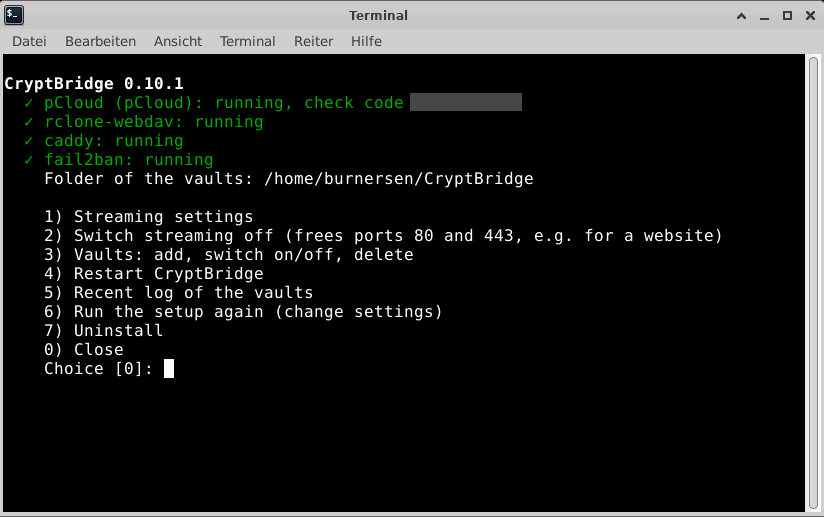

# Linux server: your own streaming server

[← Back to the README](../README.md)

*Optional, for advanced users.* Want to watch your films anywhere, without your PC at home running? Rent
a small Linux server (a VPS) and let one setup script turn it into a streaming server for your vaults in
pCloud, Google Drive, OneDrive, Dropbox or MEGA, as many as you like and in different clouds. Your
video player, for example **Infuse** on Apple TV, iPhone or iPad, then plays straight from it over a
secure connection (HTTPS). On the server itself, every vault is a folder in `~/CryptBridge`.

<p align="center">
  <br>
  <sub>The menu of the server, opened with <code>cryptbridge</code> (check code hidden here).</sub>
</p>

Tested on **Ubuntu 26.04 with an XFCE desktop**, on a server that already had its own firewall rules,
fail2ban jails and third-party package sources, with vaults in all five clouds. Made for Ubuntu 24.04 and
Debian 12 and 13 as well (not tested there yet), with or without a desktop.

- [Before you start](#before-you-start)
- [Setup](#setup)
- [Getting the block to the server](#getting-the-block-to-the-server)
- [More vaults](#more-vaults)
- [The `cryptbridge` command](#the-cryptbridge-command)
- [Ports 80 and 443 for a website](#ports-80-and-443-for-a-website)
- [Updating the server](#updating-the-server)
- [Video players](#video-players)
- [Moving to a new server](#moving-to-a-new-server)
- [What the setup does](#what-the-setup-does)

---

## Before you start

- A **host name** for your server, an internet address like `myvault.duckdns.org`: your own domain, or a
  free name from [DuckDNS](https://www.duckdns.org) (sign in, create a name, set its IP to your server's
  IP). The certificate for the secure connection is fetched automatically for it.

  > ⚠️ Host names of your provider (netcup's `…supersrv.de`, Contabo's `…contaboserver.net`) often do
  > **not** work: all customers share one limit of 50 certificates per week at Let's Encrypt, and it is
  > usually used up. DuckDNS names have a limit of their own.

  An IP address alone gets no trusted certificate, so video players refuse it. The setup explains this
  and asks for a name again.
- **Ports 80 and 443** must be reachable, also in your provider's firewall if it has one, and free: no
  other web server (such as nginx or Apache for a website) may use them. The setup checks this at the
  start, names the program and offers to pause it while streaming is on (see
  [Ports 80 and 443 for a website](#ports-80-and-443-for-a-website)). If you keep it running, everything
  else is set up without HTTPS.
- A **transfer block** of each vault you want on the server, from the Windows program (*Vaults tab > the
  page of the vault > Linux server*), or its keys at hand.

## Setup

```bash
curl -fsSLO https://raw.githubusercontent.com/burnersen/CryptBridge/main/linux/setup.sh
sudo bash setup.sh
```

The same command is on the vault's page in the Windows program (*Linux server*), with a **Copy** button.

The setup asks a few questions and does everything else. When it asks for the keys, paste the
**transfer block** and type its code (or use **Copy code** and paste it); how the block gets from your PC
to the server is explained [below](#getting-the-block-to-the-server). A mistyped code can be typed
again; the block stays. Block and code belong together: each new block gets a new code.

## Getting the block to the server

The block is created on your Windows PC (*Vaults tab > the page of the vault > Linux server > Create
transfer block*) and has to get into the setup on the server. Three ways, pick the one that suits you:

**1. SSH from Windows (recommended, the server needs no desktop).** Windows 11 has SSH built in. Open
*Terminal* (or PowerShell) and connect to your server:

```powershell
ssh yourname@your-server
```

Run the setup (or `sudo cryptbridge vault add` for another vault) and choose *1) Paste the transfer
block*. In the Windows program click **Copy block**, then paste it into the terminal with `Ctrl+V` or a
right-click; if the terminal warns that the text has several lines, paste anyway. Then click **Copy
code** and paste the code the same way (it stays invisible while you paste, that is on purpose).

**2. Remote desktop.** If your server has a desktop (for example XFCE over RDP), copy and paste work
through the remote desktop's clipboard: open a terminal on the server's desktop and paste block and code
just as above. After the setup, the server needs no desktop any more; the vaults run without it.

**3. As a file.** In the Windows program click **Save as file…** (it suggests
`CryptBridge-transfer.cbtransfer`), copy the file to the server, for example with:

```powershell
scp CryptBridge-transfer.cbtransfer yourname@your-server:
```

(or with a program like WinSCP), then choose *2) Read the transfer block from a file* in the setup and
type its **full path**, for example `/home/yourname/CryptBridge-transfer.cbtransfer` (a path with `~`
is not understood there). Type or paste the code when asked. Delete the file afterwards
(`rm ~/CryptBridge-transfer.cbtransfer`) and on your PC as well.

Whichever way: never send block and code together, for example not both in one e-mail or one chat
message. The block alone is useless without its code.

At the end the setup shows a **check code** (for example `7F3A-91C2`): it must be the same as on the
vault's page in the Windows program. If the codes match, the keys match. The setup then asks for the
vault's name: that is the name of its folder, and it suggests the name from the Windows program.

## More vaults

Every vault is a folder in `~/CryptBridge`, and your video player sees each one as a folder of the same
share. To add one, create its transfer block in the Windows program and run `sudo cryptbridge vault add`
on the server (or choose *Vaults > Add a vault* in the `cryptbridge` menu). A block of a vault that is on
the server already renews it, for example after you signed in again; it is not added twice.

- **Switched off,** a vault is unmounted and its folder disappears, for the video players too. It stays
  off, also after a restart of the server, until you switch it on again.
- **Deleting** a vault removes it from the server only: its keys, its cache and its folder. Your files
  in the cloud are not touched. If files of the vault still wait for their upload, CryptBridge says how
  many and asks before they would be lost.

## The `cryptbridge` command

The command `cryptbridge` (or the *CryptBridge* desktop icon) opens a menu. It shows the status of every
vault and the settings for your player, switches vaults or streaming on or off, adds or deletes vaults,
restarts the services or runs the setup again.

| Command | What it does |
|---|---|
| `cryptbridge` | open the menu |
| `cryptbridge vault` | list the vaults with their check codes |
| `sudo cryptbridge vault add` | add a vault, or renew one, with a transfer block |
| `sudo cryptbridge vault on NAME` / `off NAME` | switch a vault on or off (put a name with spaces in quotes) |
| `sudo cryptbridge vault delete NAME` | delete a vault from the server |
| `cryptbridge streaming` | show the settings for your video player |
| `sudo cryptbridge streaming off` / `on` | switch streaming off or on |
| `sudo cryptbridge setup` | run the setup again |
| `sudo cryptbridge uninstall` | remove everything except your files in the cloud |

## Ports 80 and 443 for a website

Need ports 80 and 443 for something else for a while, for example a website with nginx or Apache? Choose
*Switch streaming off* in the `cryptbridge` menu (or run `sudo cryptbridge streaming off`). The vault
folders keep working, only video players cannot connect. Streaming stays off, also after a restart of the
server, until you choose *Switch streaming on* (or run `sudo cryptbridge streaming on`).

If another web server uses the ports then, CryptBridge names it and offers to pause it while streaming is
on. When you switch streaming off again (or uninstall CryptBridge), it offers to start that web server
again, just as it was before, including whether it starts with the server. A web server that you switched
off yourself is never started. If streaming cannot start, a paused web server is started again at once.

## Updating the server

Download `setup.sh` again and run it (the two lines under [Setup](#setup)). To keep everything as it is,
press Enter at *Add a vault, or renew one with a new transfer block?* and at *Keep the streaming account?*.

- **Server set up with CryptBridge 0.8?** Your vault moves into a folder of its own in `~/CryptBridge`
  (you choose its name), and files still waiting for their upload move along. In your video player the
  films are then one folder deeper: open the share again (Infuse may need to update its library).
- **Server set up with CryptBridge 0.7 or older?** Download `setup.sh` again before you paste a transfer
  block of CryptBridge 0.8 or newer: the old setup only knows the old blocks and would report a wrong
  code. The new setup takes over everything of the old one.

## Video players

Any video player that can open a WebDAV share over HTTPS can play from the server. It needs these
values:

| Field | Value |
|---|---|
| Protocol | WebDAV, HTTPS on |
| Address | your server's host name |
| Port | 443 |
| Path | `/` (every vault is a folder there) |
| User / password | the user name and password you chose in the setup |

Tested with **Infuse** on Apple TV, iPhone and iPad: *Settings > Shares > Add share > WebDAV*.

> [!TIP]
> **For smooth 4K playback in Infuse:** go to *Settings > Playback (Streaming) > Buffer* and set it to
> **Generous**.

## Moving to a new server

1. Run the setup on the new server and add your vaults (paste fresh transfer blocks, or copy
   `/etc/cryptbridge/` over before the setup).
2. Check that the check codes are the same.
3. Point your host name to the new server. With your own domain your player needs no change at all; with
   a provider host name, enter the new name in the player once.
4. Uninstall on the old server: `sudo cryptbridge uninstall`.

Your files stay in the cloud the whole time; the servers only pass them through.

## What the setup does

| Step | What happens |
|---|---|
| Packages | exactly the tested rclone 1.75.2 (checked against a checksum built into the setup; another version is replaced), Caddy from Ubuntu/Debian, fuse3, ufw, fail2ban, apache2-utils |
| Keys | paste the transfer block and type its code, or enter everything by hand (pCloud only); the sign-in is kept in `/etc/cryptbridge/rclone/`, one file per vault, where rclone may renew it (Google Drive, OneDrive and Dropbox do so about every hour; MEGA's sign-in is a session that needs no renewal) |
| Check | keys tested against your vault; the check code must equal the one in the Windows program |
| Vaults | each mounted at `~/CryptBridge/NAME` for your desktop user, with a service (`rclone-mount-1.service`, `-2` ...) and a cache of its own, so one vault can be off or fail while the others keep running |
| Streaming | WebDAV for your video player serves `~/CryptBridge`, read-only (`rclone-webdav.service`), behind Caddy with HTTPS; if rclone crashes, the service comes back by itself |
| Firewall | allows 80/443 in ufw (also when ufw stays off, so they are open once it is switched on later), and keeps your SSH and remote-desktop ports open before switching ufw on |
| Protection | the streaming access is read-only, so a guessed password cannot delete anything; repeated wrong passwords are blocked by fail2ban |
| Desktop | icons *CryptBridge Vault* and *CryptBridge*, a file-manager bookmark, no film thumbnails |

Problems with the server? See [Troubleshooting](troubleshooting.md#linux-server).
